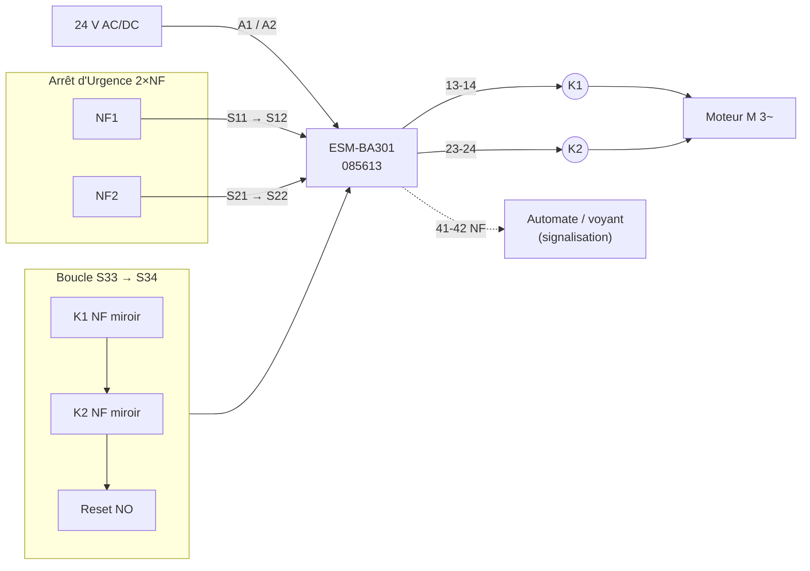

# 🛡️ EUCHNER ESM-BA301 — Relais de sécurité · Réf. 085613

| Rédacteur | Fonction | Département | Révision |
|---|---|---|---|
| **LARBI Mehdi** | Chef du village | EEA | Rév. A — 2026-11-03 |

> ⚠️ **Avant mise en service** : contrôler chaque borne et chaque valeur avec la notice constructeur EUCHNER livrée avec le produit (réf. 085613). La notice prime sur ce document en cas d'écart.

---

## 📦 1. VUE PHYSIQUE DU MODULE (face avant)

Boîtier modulaire rail DIN 35 mm, largeur 22,5 mm, bornes à vis débrochables haut / bas.

```
                 ┌───────────────────────────────┐
  BORNIER HAUT   │ ┌────┐┌────┐┌────┐┌────┐      │
  (alim + entrées│ │ A1 ││S11 ││S12 ││S33 │      │  ◄── rangée 1
   + reset)      │ └────┘└────┘└────┘└────┘      │
                 │ ┌────┐┌────┐┌────┐┌────┐      │
                 │ │ A2 ││S21 ││S22 ││S34 │      │  ◄── rangée 2
                 │ └────┘└────┘└────┘└────┘      │
                 ├───────────────────────────────┤
                 │        ███ EUCHNER ███        │
                 │                               │
                 │      ESM-BA301                │
                 │      Id.-Nr. 085613           │
                 │                               │
                 │   ( ● )  POWER   ── vert      │  ◄── LED 1 : alimentation
                 │                               │
                 │   ( ● )  CH1 / K1 ── vert     │  ◄── LED 2 : canal 1
                 │                               │
                 │   ( ● )  CH2 / K2 ── vert     │  ◄── LED 3 : canal 2
                 │                               │
                 │   ┌───────────────────────┐   │
                 │   │  24 V AC/DC           │   │
                 │   │  3 NO + 1 NC          │   │
                 │   │  Cat.4 · PL e · SIL 3 │   │
                 │   └───────────────────────┘   │
                 ├───────────────────────────────┤
                 │ ┌────┐┌────┐┌────┐┌────┐      │
                 │ │ 13 ││ 23 ││ 33 ││ 41 │      │  ◄── rangée 3
  BORNIER BAS    │ └────┘└────┘└────┘└────┘      │
  (sorties)      │ ┌────┐┌────┐┌────┐┌────┐      │
                 │ │ 14 ││ 24 ││ 34 ││ 42 │      │  ◄── rangée 4
                 │ └────┘└────┘└────┘└────┘      │
                 └───────────────────────────────┘
                        ▲ rail DIN 35 mm ▲
```

### Affectation des bornes

| Borne | Rôle | Raccordement |
|:---:|---|---|
| **A1** | Alimentation + | +24 V AC/DC |
| **A2** | Alimentation − | 0 V |
| **S11** | Sortie test canal 1 | Vers contact NF n°1 de l'AU |
| **S12** | Entrée canal 1 | Retour contact NF n°1 |
| **S21** | Sortie test canal 2 | Vers contact NF n°2 de l'AU |
| **S22** | Entrée canal 2 | Retour contact NF n°2 |
| **S33** | Circuit de démarrage (alim) | Reset + boucle de retour K1/K2 |
| **S34** | Circuit de démarrage (entrée) | Retour bouton Reset |
| **13-14** | Sortie sécurité NO n°1 | Chaîne de commande K1 / K2 |
| **23-24** | Sortie sécurité NO n°2 | Chaîne de commande K1 / K2 |
| **33-34** | Sortie sécurité NO n°3 | Réserve / 2ᵉ zone |
| **41-42** | Contact auxiliaire NF | **Signalisation uniquement** (automate, voyant) — ❌ jamais en fonction de sécurité |

---

## 🔌 2. SCHÉMAS DE CÂBLAGE

### Légende des symboles

```
 ──┤ ├──   contact NO (ouvert au repos)
 ──┤/├──   contact NF (fermé au repos)
 ──[E]──   bouton d'Arrêt d'Urgence (2 NF, à manœuvre positive d'ouverture)
 ──[R]──   bouton poussoir Reset (NO)
 ──( K )── bobine de contacteur
   ═══     liaison mécanique (contacts liés)
    ●      point de raccordement / jonction
```

---

### 2.1 Arrêt d'Urgence 2 canaux — Catégorie 4 / PL e

Câblage à 2 canaux **avec détection de court-circuit inter-canaux** (S11/S21 délivrent des signaux de test distincts).

```
  +24V ●──────────────────────────────────────────● A1
                                                   ┃
                                       ┌───────────┸───────────┐
                                       │                       │
         ARRÊT D'URGENCE (2 NF)        │                       │
              ┌─────────┐              │                       │
   S11 ●──────┤/├  NF1  ├──────● S12   │     ESM-BA301         │
              │    ═    │              │                       │
              │    ═    │  liaison     │   CANAL 1 ◄─ S11/S12  │
              │    ═    │  mécanique   │   CANAL 2 ◄─ S21/S22  │
   S21 ●──────┤/├  NF2  ├──────● S22   │                       │
              └─────────┘              │                       │
                                       │                       │
                                       └───────────┰───────────┘
                                                   ┃
   0V   ●──────────────────────────────────────────● A2
```

**Règles Cat. 4 / PL e :**

| ✅ À faire | ❌ Interdit |
|---|---|
| AU à **2 contacts NF à ouverture positive** (EN 60947-5-5) | Un seul contact ponté sur les 2 canaux |
| Deux conducteurs **séparés** par canal | Shunt S11-S12 ou S21-S22 « pour essai » laissé en place |
| Câble blindé ou pose protégée si hors armoire | Mutualiser S11 et S21 |
| Test fonctionnel de l'AU après chaque intervention | Utiliser 41-42 dans la chaîne de sécurité |

---

### 2.2 Boucle de retour (feedback) K1/K2 + Reset sur S33/S34

```
                        CIRCUIT DE DÉMARRAGE SURVEILLÉ

   S33 ●─────┬────────────┬────────────┬──────────────● S34
             │            │            │
             │   K1       │   K2       │   RESET
             └──┤/├───────┴──┤/├───────┴──[R]──┘
                 NF aux.      NF aux.     NO
                (miroir)     (miroir)

   Lecture en série :

   S33 ●───┤/├───────┤/├───────[R]────● S34
           K1        K2        RESET
          (NF)      (NF)       (NO)
```

> Le Reset n'est accepté que si **K1 ET K2 sont retombés** (leurs NF miroir fermés). Un contacteur soudé ⇒ NF ouvert ⇒ **réarmement impossible** = défaut détecté.

### 2.3 Circuit de puissance commandé par les sorties

```
  +24V ●──┬───────────────────────────────────────────┐
          │                                           │
       13 ●                                        23 ●
          │  ┤ ├  NO sécurité 1                       │  ┤ ├  NO sécurité 2
       14 ●                                        24 ●
          │                                           │
        ( K1 )  bobine                              ( K2 )  bobine
          │   ┴ diode / RC antiparasite               │   ┴ diode / RC antiparasite
   0V  ●──┴───────────────────────────────────────────┘

  PUISSANCE (moteur) — contacts K1 et K2 en SÉRIE :

   L1 ●──┤ ├──┤ ├──●─────┐
   L2 ●──┤ ├──┤ ├──●───┐ │
   L3 ●──┤ ├──┤ ├──●─┐ │ │
         K1    K2    │ │ │
                    ( M  )
                     3~
```

### 2.4 Vue d'ensemble (Mermaid)



### 2.5 Séquence de fonctionnement

| Étape | Action | AU | K1/K2 NF | Reset | Sorties 13-14 / 23-24 |
|:---:|---|:---:|:---:|:---:|:---:|
| 1 | Mise sous tension | Fermé | Fermés | — | 🔴 Ouvertes |
| 2 | Appui Reset | Fermé | Fermés | Front | 🟢 **Fermées** |
| 3 | Marche machine | Fermé | Ouverts | — | 🟢 Fermées |
| 4 | Frappe AU | **Ouvert** | — | — | 🔴 Ouvertes immédiatement |
| 5 | Déverrouillage AU | Fermé | Fermés | — | 🔴 Ouvertes (attente reset) |
| 6 | Reset | Fermé | Fermés | Front | 🟢 Fermées |

---

## 💡 3. TABLEAU SYNOPTIQUE DE DIAGNOSTIC LED

Légende : 🟢 allumée · ⚫ éteinte · 🟡 clignotante (selon version)

| POWER | CH1 | CH2 | État du relais | Cause probable | Action |
|:---:|:---:|:---:|---|---|---|
| ⚫ | ⚫ | ⚫ | **Hors tension** | Pas de 24 V sur A1/A2, fusible HS, inversion | Mesurer A1-A2 · contrôler disjoncteur/fusible |
| 🟢 | ⚫ | ⚫ | **Prêt / sorties ouvertes** | AU actionné, ou reset non effectué | Déverrouiller AU → appuyer Reset |
| 🟢 | ⚫ | ⚫ | **Reset refusé** | Boucle S33-S34 ouverte : K1 ou K2 collé/soudé, NF miroir HS, fil coupé | Mesurer continuité S33 → K1 NF → K2 NF → Reset |
| 🟢 | 🟢 | 🟢 | ✅ **Fonctionnement normal** | Sorties fermées, machine autorisée | — |
| 🟢 | 🟢 | ⚫ | ❌ **Défaut canal 2** | Fil S21/S22 coupé, contact NF2 de l'AU défectueux, désynchronisation | Contrôler NF2 et câble S21-S22 · actionner AU puis Reset |
| 🟢 | ⚫ | 🟢 | ❌ **Défaut canal 1** | Fil S11/S12 coupé, contact NF1 de l'AU défectueux | Contrôler NF1 et câble S11-S12 · actionner AU puis Reset |
| 🟢 | ⚫ | ⚫ | ❌ **Court-circuit inter-canaux** | Contact entre fils S11/S21 ou S12/S22 (câble écrasé, presse-étoupe) | Isoler, mesurer l'isolement entre canaux, remplacer le câble |
| 🟢 | ⚫ | ⚫ | ❌ **Court-circuit à la masse / 0 V** | Conducteur d'entrée à la terre | Mesure d'isolement, contrôle des boîtes de jonction |
| 🟢 | 🟢 | 🟢 | ⚠️ **Sorties fermées mais machine à l'arrêt** | Bobine K1/K2 HS, protection bobine ouverte, défaut aval | Mesurer tension sur 14 et 24 |
| 🟢 | 🟢/⚫ | 🟢/⚫ | ❌ **Défaut interne relais** | Contact de sortie soudé, électronique HS | **Remplacer le module** — aucune réparation |

> 🔍 **Discriminer les défauts à LED identiques (🟢 ⚫ ⚫)** :
> 1. AU déverrouillé ? → sinon c'est normal.
> 2. Mesure S33-S34 avec Reset appuyé : **0 Ω attendu**. Sinon → boucle de retour.
> 3. Mesure S11-S12 et S21-S22 AU fermé : **0 Ω attendu**. Sinon → canal coupé.
> 4. Mesure isolement entre conducteurs S12 et S22 : **∞ attendu**. Sinon → court-circuit inter-canaux.

---

## 📋 4. FICHE TECHNIQUE CONDENSÉE

| Caractéristique | Valeur |
|---|---|
| **Fabricant / Désignation** | EUCHNER — ESM-BA301 |
| **Référence (Id.-Nr.)** | 085613 |
| **Fonction** | Relais de sécurité de base : AU, protecteurs, interrupteurs de sécurité |
| **Tension d'alimentation Uₛ** | 24 V AC/DC |
| **Contacts de sécurité** | **3 NO** (13-14 · 23-24 · 33-34) |
| **Contact auxiliaire** | **1 NF** (41-42) — signalisation uniquement |
| **Nombre de canaux d'entrée** | 1 ou 2 (2 canaux obligatoires pour Cat. 4) |
| **Détection court-circuit inter-canaux** | Oui (câblage 2 canaux) |
| **Démarrage** | Manuel surveillé via S33-S34 (avec boucle de retour) |
| **Catégorie EN ISO 13849-1** | **Cat. 4** |
| **Niveau de performance** | **PL e** |
| **Niveau d'intégrité IEC 62061 / IEC 61508** | **SIL CL 3 / SIL 3** |
| **Diagnostic** | 3 LED : Power · CH1 · CH2 |
| **Montage** | Rail DIN 35 mm (EN 60715) |
| **Largeur boîtier** | 22,5 mm |
| **Indice de protection** | Boîtier IP40 · bornes IP20 → montage en armoire ≥ IP54 |
| **Protection des sorties** | Fusible externe sur les contacts de sortie (calibre selon notice) |

### ✔️ Check-list mise en service

- [ ] A1-A2 = 24 V mesuré, polarité respectée en DC
- [ ] AU 2 × NF, 2 canaux séparés S11-S12 / S21-S22
- [ ] Boucle S33-S34 : NF K1 + NF K2 + Reset NO en série
- [ ] Contacteurs K1/K2 à **contacts miroirs** (EN 60947-4-1, annexe F)
- [ ] Puissance coupée par K1 **ET** K2 en série
- [ ] Antiparasitage des bobines (diode / RC)
- [ ] 41-42 utilisé uniquement en signalisation
- [ ] Test : frappe AU → arrêt · Reset AU enfoncé → refus · Simulation K1 collé → Reset refusé
- [ ] Validation consignée (date, intervenant, résultat)
